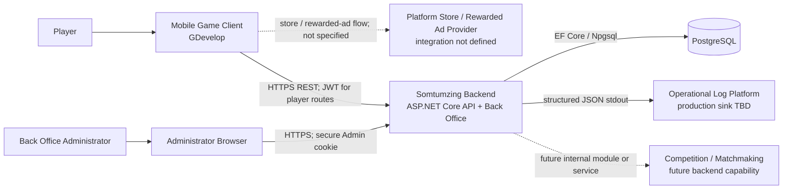
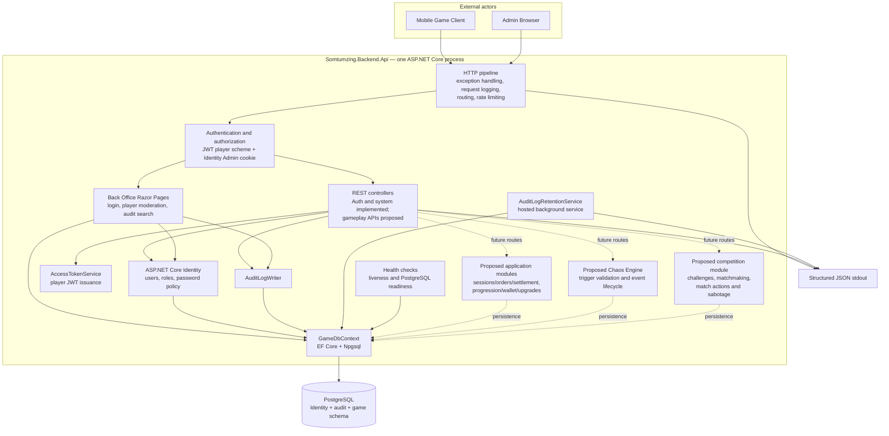
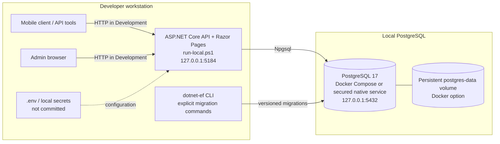
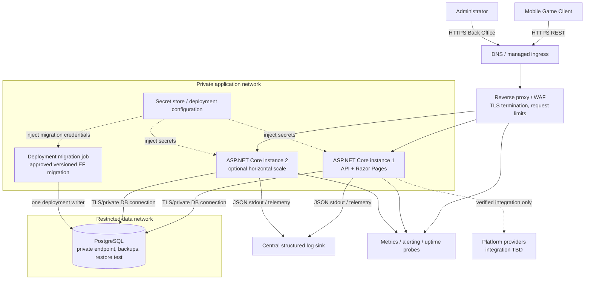
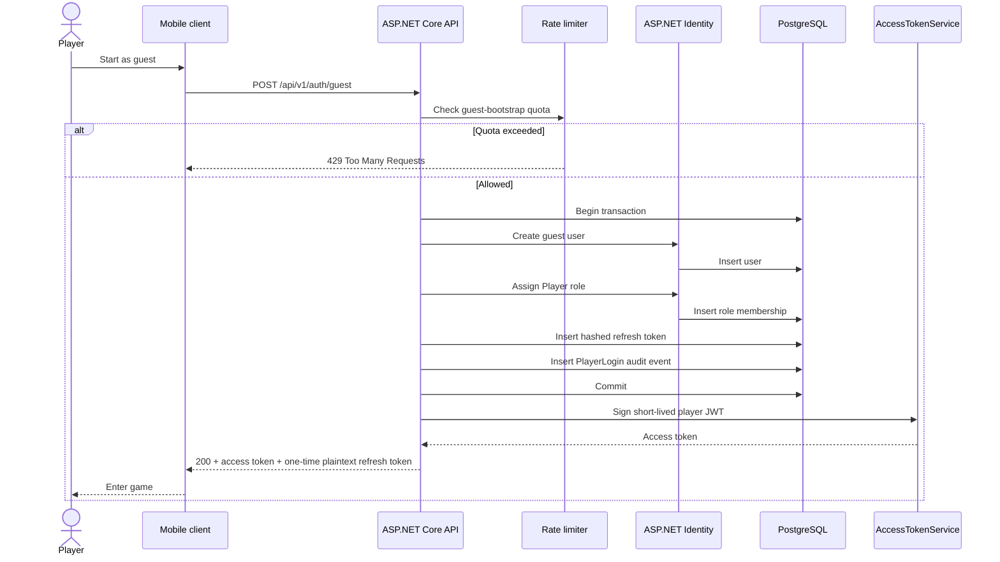
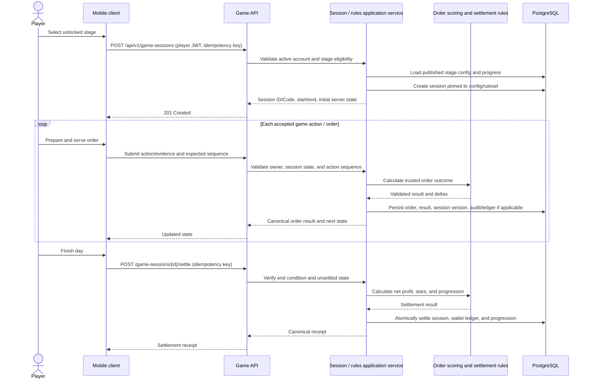
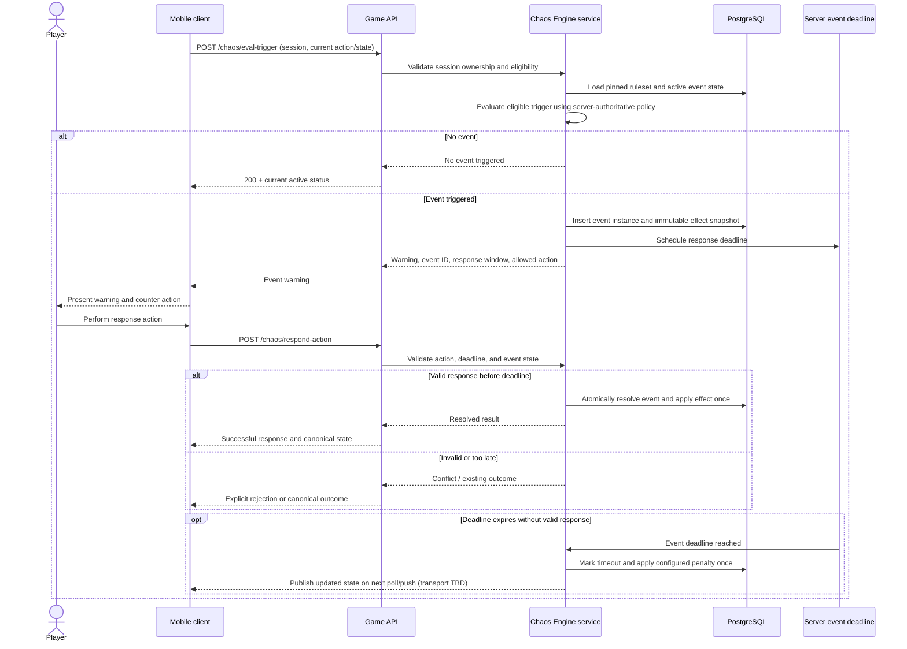
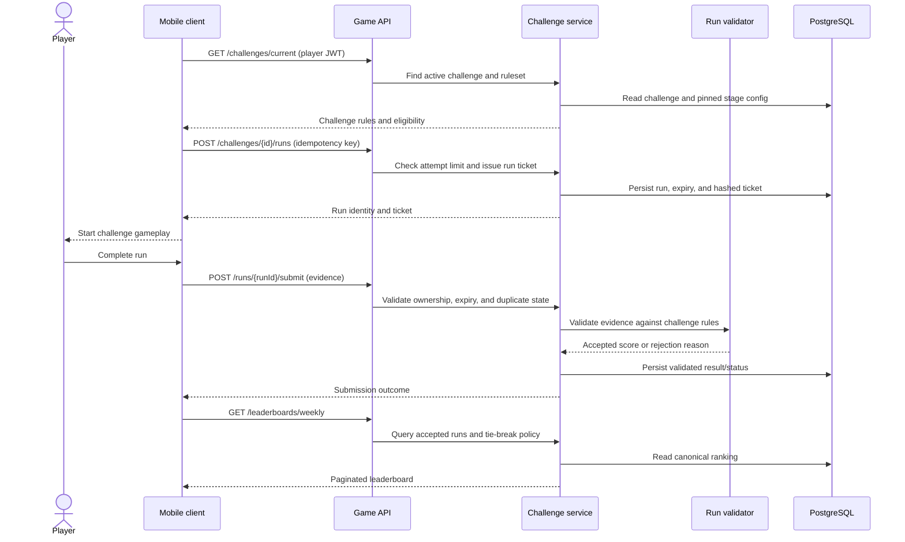
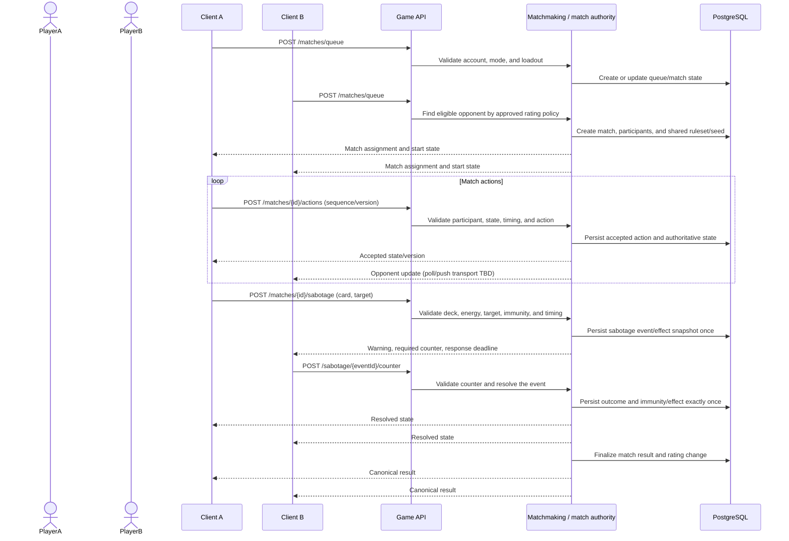

# Somtum Zabb Delivery — Software Design Specification: Architecture

**Document status:** Draft 0.1 — architecture proposal for review
**System:** Somtum Zabb Delivery backend
**Last reviewed:** 2026-10-08
**Related documents:** [Use Cases](./SDS-Use-Cases.md), [API Specification](./API-Specification.md), [Database Design](./Database-Design.md)

> This document describes both the current implementation and a proposed target architecture. Diagrams mark proposed components and integrations explicitly; a box in a target diagram is not evidence that the component has been implemented or deployed.

## 1. Purpose and scope

This architecture specification explains the backend structure and runtime interactions needed to support the mobile game, persistent player data, and web Back Office. It covers:

- System context and trust boundaries.
- Logical components and their responsibilities.
- Local development deployment and a production deployment target.
- Key runtime sequences for authentication, gameplay, Chaos, competition, and Back Office actions.
- Security, reliability, operational, and evolution constraints.

Game-client UI, GDevelop event-sheet implementation, artwork/audio delivery, payment-provider internals, and production infrastructure details that have not been selected are outside the committed design. Proposed gameplay endpoints and competition components remain subject to approval of their rules and API contracts.

## 2. Architecture overview

### 2.1 Architectural style

The current backend is a single ASP.NET Core application using a modular-monolith approach:

- REST API controllers and health endpoints serve the mobile client.
- ASP.NET Core Razor Pages serve the authenticated Back Office in the same process.
- ASP.NET Core Identity manages player and administrator identities and roles.
- Entity Framework Core with Npgsql persists application data in PostgreSQL.
- Structured operational logs go to standard output; important security and Back Office events are also persisted as audit records.

This keeps the first release simple to develop and deploy. It is not currently a collection of microservices. Matchmaking, real-time match coordination, challenge validation, authoritative game simulation, and payment integration are future responsibilities and are not implemented by the current backend.

The initial target should retain this single deployable unless approved throughput, availability, or operational needs justify extracting a bounded context. In particular, do not introduce a message broker, distributed cache, or separate match service only because it appears in a future-facing diagram.

### 2.2 System context



The game client is an untrusted presentation and input endpoint. It may submit player actions and evidence but is not an authority for balances, progression, scores, match outcomes, or event outcomes. The precise server-authority model for gameplay is still an open decision.

### 2.3 Context and trust boundaries

| Boundary | Traffic / data | Required controls |
|---|---|---|
| Mobile client → backend | Public game API, player access token, refresh token only on refresh/logout routes | HTTPS in deployed environments; validate JWT issuer, audience, signature, lifetime, role, account status, and security stamp; rate-limit anonymous account bootstrap; never trust a submitted player identity |
| Administrator browser → Back Office | Razor Pages, administrator credentials, session cookie, moderation/audit data | HTTPS; HttpOnly and SameSite cookie; Secure cookie outside Development; antiforgery protection on state-changing forms; authorization policy and Admin role |
| Backend → PostgreSQL | Identity, refresh-token hashes, audit records, and game data | Private network; least-privilege database role; TLS where network topology requires it; secrets injected from protected configuration; parameterized EF Core access |
| Backend → log sink | Structured operational logs and request metadata | Do not record passwords, tokens, request bodies, or connection strings; restrict log access and retention |
| Backend → future providers | Purchase receipts or rewarded-ad callbacks, if approved | Provider-specific signature/receipt validation and idempotency; do not grant value from client assertion alone |
| Client ↔ client / peer network | Not part of current backend architecture | Direct peer trust is not accepted for authoritative state; online transport and authority model require an explicit decision |

## 3. Component architecture

### 3.1 Component diagram



### 3.2 Component responsibilities and current state

| Component | Responsibility | State |
|---|---|---|
| HTTP pipeline | Exception-to-problem handling, request correlation, request logging, routing, rate limiting, authentication and authorization | Implemented |
| Authentication API | Guest creation, access-token issuance, refresh-token rotation, logout, and current-player profile | Implemented |
| Player token validation | Validate JWT and compare account suspension/security stamp with current database state | Implemented |
| Back Office | Administrator sign-in, player search/suspension/reactivation, audit search | Implemented |
| Audit writer | Write safe event metadata and details to PostgreSQL | Implemented |
| Audit retention worker | Delete audit events beyond configured retention; run at startup and every 24 hours | Implemented |
| Health endpoints | Liveness and database readiness | Implemented |
| Stage/progression/session/order services | Serve stage config, persist authoritative sessions/orders/results, settle days | Proposed; no gameplay API controllers yet |
| Wallet/economy services | Atomically update wallet and immutable transaction ledger | Proposed; schema designed, service behavior not implemented |
| Chaos Engine | Validate triggers, event state transitions, timeouts, and apply effects once | Proposed |
| Challenge service | Issue run tickets, validate submissions, and query the canonical leaderboard | Proposed |
| Matchmaking and real-time match service | Queue players, coordinate actions, validate results, and resolve disconnects | Proposed; transport and authority model undecided |
| Sabotage service | Validate deck, energy, target, counter action, immunity, and effect application | Proposed |
| Store/reward integration | Verify platform purchase/ad evidence and grant approved rewards | Not specified or implemented |

### 3.3 Internal layering

The current project is intentionally small and does not yet have separate domain/application/infrastructure projects. As game features are implemented, keep boundaries in the existing API project or extract projects only when useful:

1. **Presentation:** controllers, request/response contracts, Razor Pages, and health endpoints. Validate transport-level input and derive player identity from the authenticated principal.
2. **Application:** use-case handlers/services for auth, account moderation, game sessions, order resolution, settlement, wallet operations, challenges, and matches.
3. **Domain:** game rules, status transitions, score calculations, and policy decisions. Pure calculations should be testable without database or HTTP dependencies.
4. **Infrastructure:** `GameDbContext`, EF mappings/migrations, Identity stores, logging/audit persistence, and provider clients.

Controllers and Razor Page handlers should orchestrate a use case rather than implement game rules inline. Financial/progression writes and their ledger/result records must share one database transaction and idempotency boundary.

## 4. Data architecture

### 4.1 Persistence

- PostgreSQL is the authoritative store for account identity, refresh-token hashes, persisted audit events, and future game data.
- Entity Framework Core 10 with Npgsql is the current persistence provider.
- Schema changes are versioned EF Core migrations and are applied explicitly; do not rely on API startup to mutate production schema.
- UUID primary/foreign keys are internal relationships. `Code` is an externally displayable reference, not an authorization secret.
- Proposed game tables, audit fields, lifecycle states, and relationships are detailed in [Database Design](./Database-Design.md).

### 4.2 Data ownership and consistency

| Data | Owner / source of truth | Consistency rule |
|---|---|---|
| Player/admin identity and roles | ASP.NET Identity in PostgreSQL | Unique normalized username; authorization from validated server-side identity |
| Refresh credentials | Backend; only a SHA-256 hash is persisted | Rotation and revocation are transactional; plaintext is returned only to the caller |
| Audit events | Backend audit writer | Persist with the business transaction when a change must be auditable atomically |
| Stage/ruleset catalog | Back Office/admin publishing workflow (proposed) | A session, challenge, or match pins the exact config/ruleset version |
| Session/order/economic result | Backend calculation and persistence (proposed) | Do not trust client-computed totals; apply each result once |
| Challenge leaderboard | Accepted backend-validated challenge runs (proposed) | Reject invalid/expired/duplicate attempts; ranking tie-breaks remain open |
| Match outcome/rating | Trusted match authority (proposed) | Do not accept one client’s winner/score report as canonical |

### 4.3 Code generation

The database schema includes a monthly atomic Code allocator and immutable table-code registry. Codes must be generated inside the database, be unique, and never be changed after external disclosure. Code allocation is not an authentication or authorization mechanism.

## 5. Deployment architecture

### 5.1 Current local development topology



Local development uses loopback-bound endpoints. The sample Docker Compose file provisions PostgreSQL only; it does not containerize the API. `run-local.ps1` loads `.env`, applies migrations, then starts the API. Do not expose this setup to a public network.

### 5.2 Production deployment target (proposed)



This is a target, not the current environment. Hosting vendor, region, ingress/WAF product, database topology, number of instances, observability vendor, recovery objectives, and provider integrations are undecided.

### 5.3 Deployment requirements

- Terminate TLS at an approved edge and forward only trusted proxy headers. Configure the ASP.NET Core forwarded-header trust list before using forwarded client IP addresses for audit or rate limiting.
- Keep PostgreSQL off the public internet and restrict connections to application/migration identities. Use separate least-privilege credentials where practical.
- Store JWT signing keys, database passwords, and administrator bootstrap credentials in a protected secret store. Never bake them into the image, source tree, or deployment logs.
- Build immutable API artifacts/images in CI. Run schema migrations as an explicit, observable deployment step with a single migration runner; take/verify backups according to the approved recovery plan.
- Apply readiness checks before routing traffic. Liveness must not depend on PostgreSQL; readiness should fail when required persistence is unavailable.
- Use rolling deployment only when the schema change is backward-compatible with both old and new application versions.
- Centralize structured stdout logs, health checks, process metrics, and database availability alerts. Retention and access control must be defined for both operational and persisted audit records.

## 6. Runtime sequence diagrams

### 6.1 UC-01 — Create guest account

Implemented flow. Guest bootstrap is limited by client IP; role, user, refresh token, and audit event creation occur in the same database transaction.



Refresh tokens are rotated and stored only as hashes. A refresh attempt checks expiration/revocation and suspension before issuing a replacement. Player access tokens are checked against current suspension and security-stamp state.

### 6.2 Proposed — Start a casual session, serve an order, and settle

This sequence is a target use case, not a set of deployed gameplay endpoints. Server authority, action evidence, order generation, settlement rules, and exact idempotency contracts must be finalized first.



The trusted `Rules` component is conceptual. A client may supply input/evidence but must not directly set canonical revenue, stars, wallet balances, or progression.

### 6.3 Proposed — Chaos trigger and response

The event lifecycle and response windows are proposals. Event generation, timing authority, stacking, and whether a client can request evaluation remain open design decisions.



### 6.4 Proposed — Weekly challenge run and leaderboard

The proposed model treats backend-validated runs as the canonical leaderboard source. A client-reported score by itself is insufficient.



### 6.5 Proposed — Real-time match and sabotage

This diagram is a logical interaction only. Matchmaking, transport (for example HTTPS polling, WebSocket, or another managed service), server authority, queues, reconnect semantics, and deployment topology have not been selected. Do not interpret the diagram as implementing direct peer-to-peer game authority.



### 6.6 Implemented — Back Office player moderation and audit

```mermaid
sequenceDiagram
    actor Admin
    actor Player
    participant Browser as Admin browser
    participant Pages as Razor Pages
    participant API as Player API
    participant Identity as Identity cookie + Admin policy
    participant DB as PostgreSQL
    participant Audit as AuditLogWriter

    Admin->>Browser: Sign in
    Browser->>Pages: POST /Admin/Login (credentials + antiforgery)
    Pages->>Identity: Validate administrator
    Identity->>DB: Read user and Admin role
    Identity-->>Browser: Secure administrator cookie

    Admin->>Browser: Search/select player and submit reason
    Browser->>Pages: POST suspend/reactivate (cookie + antiforgery)
    Pages->>Identity: Require authenticated Admin role
    Pages->>DB: Begin transaction; load player
    Pages->>DB: Update status/suspension metadata and security stamp
    Pages->>Audit: Write AdminAction event
    Audit->>DB: Insert audit row
    Pages->>DB: Commit
    Pages-->>Browser: Redirect with action result

    opt Later player request with pre-suspension JWT
        Player->>API: Request using old JWT
        API->>DB: Compare current suspension/security stamp
        API-->>Player: Reject with unauthorized response
    end
```

Audit data is distinct from structured operational stdout logs. Administrative mutations and their audit event should remain transactionally consistent.

## 7. Security architecture

### 7.1 Authentication and authorization

- Player API requests use signed JWT bearer tokens. The current access-token lifetime is 15 minutes; refresh credentials rotate and are stored as SHA-256 hashes.
- Player authorization is based on the authenticated principal and current account/security-stamp state. A client-supplied `PlayerId` must never override the token subject.
- The Back Office uses a separate ASP.NET Identity application cookie and requires the Admin role.
- Guest bootstrap uses an IP-keyed fixed-window limiter (20 attempts/minute in the current configuration). Production deployment must correctly trust only configured reverse proxies so IP partitioning cannot be spoofed.
- Admin state-changing forms require antiforgery validation. REST mutations require endpoint-specific authorization, validation, and idempotency rules.
- Provider account linking is not implemented. Store receipts and rewarded-ad callbacks require verified server-side evidence before granting entitlements.

### 7.2 Secrets and data minimization

- JWT signing key, database password, admin bootstrap password, and provider credentials are secrets and must be supplied through protected configuration.
- Never log credentials, access/refresh tokens, request bodies, or connection strings.
- Refresh-token plaintext is transient and returned only to the client; persist only the token hash.
- Restrict audit details to operationally necessary data. Apply configured retention and access controls to audit/operational logs.
- Keep sensitive match seeds and future anti-cheat evidence server-side; only publish information necessary for the client to render gameplay.

### 7.3 Abuse and integrity

- Validate all client input at the API boundary and again against the authoritative resource state.
- Use idempotency keys and database uniqueness/transactions for purchases, settlement, challenge submission, match actions, and effects.
- Enforce ownership and match participation in the service layer; opaque codes are not authorization checks.
- Rate-limit authentication and other abuse-prone endpoints. Set request/body size limits and timeouts at the edge and application.
- Anti-cheat requirements, authoritative simulation, device attestation, and evidence retention are still open decisions; a shared random seed alone does not prevent score forgery.

## 8. Reliability, performance, and operations

### 8.1 Reliability

- A database outage makes persistence-dependent APIs unavailable; readiness must report failure rather than success-shaped fallback.
- Transactions protect atomic changes to identity/refresh rotation, audit-worthy admin actions, wallet ledger entries, settlements, and match outcomes.
- Background retention is best-effort and logs database failures; alerting for repeated worker failure should be configured in production.
- Use database backups and tested point-in-time recovery according to an agreed RPO/RTO. These targets have not been selected.
- Deploy schema changes additively where possible and maintain compatibility during rolling application deployments.

### 8.2 Performance and scaling

- Scale the stateless API horizontally only after confirming cookie/JWT validation, rate limiting, and background work behave correctly across instances.
- The current in-memory rate limiter is per process; in a multi-instance deployment, global abuse limits require an approved shared/distributed strategy or edge enforcement.
- The audit retention worker currently runs in each API process. Before horizontal production scale, elect a single worker/migration job or otherwise prevent concurrent duplicate scheduled work.
- PostgreSQL connection pool limits, query indexes, pagination, and workload isolation must be load-tested with expected player and Back Office traffic.
- No cache, broker, or dedicated real-time transport is currently required by implemented functionality.

### 8.3 Observability

- Emit structured JSON logs with UTC timestamps, severity, event type, request/trace ID, HTTP method/path/status, and elapsed duration.
- Do not include query strings or request bodies in request logs.
- Monitor liveness, database readiness, API error/latency rates, authentication rejections, rate-limit responses, audit-retention failures, and PostgreSQL capacity.
- Correlate client support reports using trace/request IDs without exposing internal database primary keys or secrets.

## 9. Architecture decisions and open questions

### 9.1 Current decisions reflected in code

| Decision | Current choice |
|---|---|
| Backend implementation | ASP.NET Core 10 modular monolith |
| API protocol | Versioned REST API under `/api/v1` |
| Back Office | Razor Pages in the same ASP.NET Core host |
| Persistence | PostgreSQL with EF Core/Npgsql and explicit migrations |
| Player authentication | Guest-first Identity accounts, short-lived JWT, rotating opaque refresh token |
| Admin authentication | ASP.NET Identity cookie and Admin role |
| Operational logging | Structured JSON to stdout |
| Security audit | PostgreSQL audit events with configured retention |

### 9.2 Decisions required before gameplay implementation

1. What is authoritative for casual gameplay: server-simulated events/actions, server-validated action log, or client simulation with evidence checks?
2. How are order sequences and random events generated, seeded, persisted, replayed, and protected from manipulation?
3. What is the final calculation/versioning policy for recipe accuracy, patience, stars, daily rating, net profit, and unlocks?
4. Is real-time PVP in the first release? If yes, select transport, match authority, server tick/event model, queue mechanism, reconnect/forfeit behavior, and regional topology.
5. What are MMR/rank formulas, season boundaries, normalized stats, tie-breaks, and reward rules?
6. What is the final Chaos registry and overlap policy? The submitted registry names eight events but currently describes six; the synergy formula is not settled.
7. Which purchase/ad providers are used, how are receipts/callbacks verified, and what refund/chargeback behavior is required?
8. What are production hosting provider/region, database HA, backup/RPO/RTO, log platform/retention, alert thresholds, and privacy/data-deletion requirements?
9. How will multi-instance rate limiting, scheduled audit retention, and any future matchmaker background work be coordinated?

Until these are resolved, competition, Chaos, challenge, and economy diagrams are design proposals and must not be treated as approved implementation contracts.

## 10. Traceability

| Architecture area | Related use cases | API specification | Database design |
|---|---|---|---|
| Player identity/token flow | UC-01 | Implemented auth endpoints, sections 2.4–2.7 | Users, Roles, UserRoles, RefreshTokens |
| Stage/session/order flow | UC-02–UC-04 | Proposed progression/gameplay endpoints, sections 3–4 | Stages, StageConfigs, GameSessions, Orders, OrderResults |
| Chaos and patience | UC-05 | Proposed Chaos endpoints, section 5 | ChaosEventDefinitions, ChaosEventInstances |
| Settlement/economy | UC-06–UC-07 | Proposed wallet/upgrade endpoints, section 6 | Wallets, WalletTransactions, Upgrades, PlayerUpgrades |
| Challenge/leaderboard | UC-08 | Proposed challenge endpoints, section 7 | Challenges, ChallengeRuns |
| Real-time match/sabotage | UC-09–UC-10 | Proposed match/sabotage endpoints, sections 8–9 | Matches, MatchParticipants, MatchActions, MatchResults, SabotageCards, PlayerLoadouts, MatchSabotageEvents |
| Back Office and audit | UC-11–UC-12 | Current Back Office is cookie-authenticated Razor Pages; no REST routes in the API draft | Users, AuditLogEntries |
